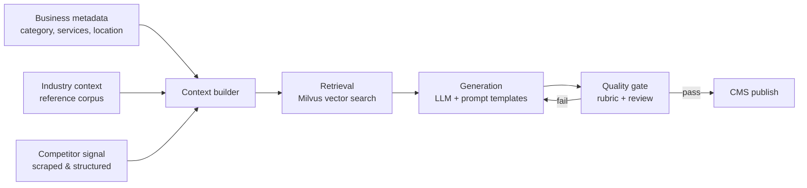

# Context-aware website content generation

**Role:** Lead AI Engineer, Spotzer Digital · **Status:** In production
**Impact:** ~$120K/year in content-production costs eliminated, measured against prior manual/agency-produced copy across the client site portfolio

---

## Problem

Spotzer builds and hosts websites for a large portfolio of small-and-medium-business clients. Every site needs original, SEO-viable copy — service pages, location pages, "about" content — and that copy has to sound like it was written for *this* business, not a template with the name swapped in. Before this system, that copy was written manually or outsourced, which meant the cost scaled linearly with the number of sites and pages, and turnaround time was measured in days, not minutes.

The brief: generate business-specific website content automatically, at a quality bar that doesn't need a human rewrite before it ships, without the cost or latency of the manual process.

## Constraints

- **No client-specific training data.** Most client businesses have almost no existing web presence to learn from — the system has to work from structured business metadata (category, services, location) plus external signal, not fine-tuning.
- **Quality has to be defensible, not just fast.** SEO-facing copy that reads as generic or duplicated across sites actively hurts client search rankings, so "plausible-sounding" wasn't a high enough bar.
- **Had to slot into an existing CMS**, not replace it — publishing, versioning, and rollback all needed to keep working exactly as before.
- **Cost-sensitive by definition.** A generation pipeline that's cheaper than a human but still expensive per page doesn't solve the problem it's meant to solve.

## Architecture

1. **Context builder** assembles everything known about a business — structured metadata, category taxonomy, location — into a retrieval query.
2. **Retrieval** pulls the most relevant reference material (industry-specific phrasing patterns, structured competitor signal) from a Milvus vector index, rather than relying on the LLM's parametric knowledge alone. This is what keeps output specific instead of generic.
3. **Generation** runs the retrieved context plus business metadata through prompt templates tuned per content type (service page vs. location page vs. about page), rather than one general-purpose prompt.
4. **Quality gate** scores output before it's eligible to publish; content that doesn't clear the bar is regenerated or routed for review rather than shipped as-is.
5. **CMS publish** integrates with the existing publishing pipeline so this looks, to the rest of the org, like just another content source.

## Key decisions and trade-offs

- **Milvus over a managed vector store.** At the scale of the client portfolio, self-hosting Milvus on infrastructure already in place was materially cheaper than a managed alternative, and the team already had the Docker/AWS operational muscle to run it — the trade-off was more ops surface for lower marginal cost, which made sense given this runs continuously at volume rather than as a low-traffic feature.
- **Retrieval-augmented, not fine-tuned.** Fine-tuning per vertical would have meant a model (and a retraining cycle) per business category. RAG let one pipeline serve every category by swapping what gets retrieved, which mattered more here than it would for a narrower product, given how many distinct business categories the platform serves.
- **A quality gate before publish, not after.** The cheap version of this system generates content and ships it. The version that actually survives contact with SEO and client review generates, scores, and only then ships — the gate is what makes "cheaper than a human" also mean "not worse than a human."
- **Prompt templates per content type instead of one general template.** Service pages, location pages, and about pages have different structural expectations; a single template regressed toward the mean and needed more post-generation correction than type-specific templates did.

## Results

Manual/agency content production for this volume of sites was the prior cost baseline; replacing it with this pipeline is where the ~$120K/year figure comes from. Just as important operationally: turnaround dropped from a multi-day manual cycle to something close to on-demand, which changed what the business could offer clients, not just what it cost to deliver.

## What I'd do differently

- **I'd invest in automated quality scoring earlier.** Early on, review leaned more on spot checks than a systematic rubric; formalizing scoring sooner would have caught category-specific failure modes faster.
- **I'd design the competitor-signal pipeline for staleness from day one.** Scraped competitor context degrades as competitor sites change; a scheduled refresh should have been part of the initial design rather than added after the fact.
- **I'd separate "retrieval quality" evaluation from "generation quality" evaluation from the start.** Early debugging conflated the two — a lot of investigation time went into generation prompts when the actual issue was retrieval returning weakly relevant context.
